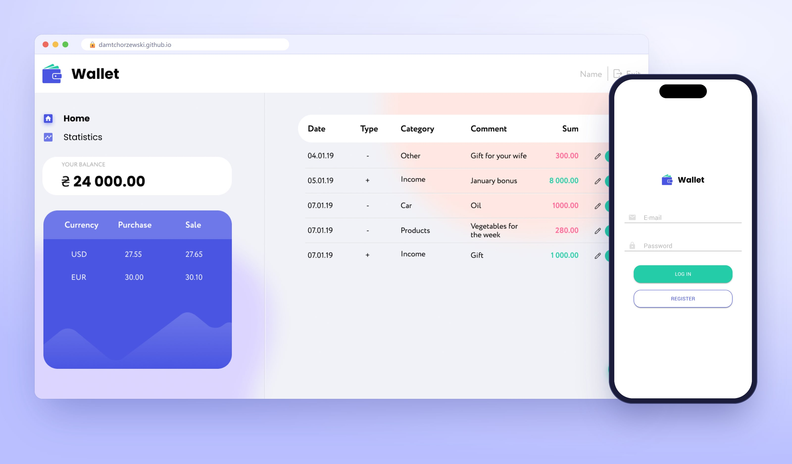
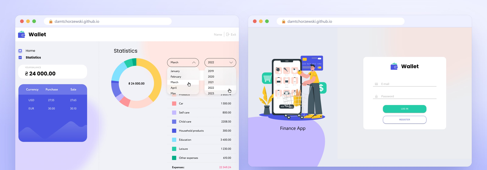

<p align="center">
  <picture>
    <source media="(prefers-color-scheme: dark)" srcset="docs/images/banner-dark.png">
    
  </picture>
</p>

<p align="center">
  
</p>

## About

<a href="https://damtchorzewski.github.io/personal-finance-manager/"></a>

**Wallet Manager** is a cutting-edge application tailored for efficient personal finance management. With a user-centric
design and adaptability across diverse devices, it empowers users to effortlessly monitor transactions, track account
balances, analyze expenditures, and strategize budgets.

- **Accounts.** Sign-up with e-mail confirmation, and sign-in with e-mail and password or with a Google account, both
  through Firebase Authentication; the private pages are guarded by `PrivateRoute` / `RestrictedRoute`. The link in the
  confirmation e-mail returns to the site, where `src/services/emailAction.js` applies it and refreshes the session.
- **Demo mode.** "Try the demo" on the login page opens the app with sample transactions and no account; the demo's
  data is kept in the browser's localStorage (`src/services/demo.js`), works without the API, and "Demo · reset
  data" in the header restores the sample data.
- **Transactions.** A table of income and expenses with add, edit and delete windows (`ModalAddTransaction`,
  `ModalEditTransaction`) and the account balance next to it.
- **Statistics.** A doughnut chart (Chart.js) and a table of expenses by category for a chosen month and year.
- **Currency rates.** A USD and EUR purchase and sale table from the National Bank of Poland API.
- **Responsive.** A separate mobile dashboard (`DashboardMobile`) is chosen with `react-media`; a loader covers the
  waits for the API.
- **Deployed by Actions.** A push to `main` builds the app with the Firebase settings and the API address from the
  repository variables and publishes it to the `gh-pages` branch, which GitHub Pages serves.

> **Status:** the API is [`personal-finance-manager-api`](https://github.com/DamTchorzewski/personal-finance-manager-api) on
> Google Cloud Run; it scales to zero, so the first request after a pause is slower.

## Tech stack

|          |                                                                                                                  |
| -------- | ---------------------------------------------------------------------------------------------------------------- |
| Stack    | React 18, JavaScript (JSX), [Vite 4](https://vitejs.dev/), React Router 6                                        |
| UI       | MUI 5 with Emotion, CSS modules, `react-hook-form`, `notiflix`, `react-loader-spinner`, `react-media`            |
| Data     | Redux Toolkit, `redux-persist`, `axios`                                                                          |
| Charts   | Chart.js 4 with `react-chartjs-2`                                                                                |
| Services | Firebase Authentication, the API ([`personal-finance-manager-api`](https://github.com/DamTchorzewski/personal-finance-manager-api)), exchange rates of the National Bank of Poland |
| Tests    | none                                                                                                             |
| Hosting  | GitHub Pages (`gh-pages` branch), built and published by GitHub Actions (`.github/workflows/deploy.yml`)          |

The interface is in English; code and commits are in English.

## Screenshots

<p align="center">
  
</p>
<p align="center">
  
</p>

The dashboard and the statistics need an account on the API, so their images are the screenshots the team saved in
`src/utils/` (`dash.png`, `stat.png`); the login, registration and phone images are the live pages.

## Quick start

```bash
git clone https://github.com/DamTchorzewski/personal-finance-manager.git
cd personal-finance-manager
npm install
npm run dev      # http://localhost:5173/personal-finance-manager/
```

Requirements: Node.js 18 LTS or newer and npm (the workflow builds with Node 18). The app is served under the
`/personal-finance-manager` base path (`vite.config.js`).

## Scripts

| Command           | What it does                                                         |
| ----------------- | -------------------------------------------------------------------- |
| `npm run dev`     | development server with hot reload (`vite`)                          |
| `npm run build`   | production build to `dist/` (what the workflow runs)                 |
| `npm run preview` | serves the production build locally                                  |
| `npm run lint`    | ESLint over `src`, no warnings allowed                               |

## Configuration

The file is `.env.example` (names only, copy it to `.env.local`). None of the variables is a secret: they are the
public settings of the Firebase web app and the address of the API, baked into the build.

| Variable                                                                                                        | What it is                                              |
| --------------------------------------------------------------------------------------------------------------- | ------------------------------------------------------- |
| `VITE_FIREBASE_API_KEY`, `VITE_FIREBASE_AUTH_DOMAIN`, `VITE_FIREBASE_PROJECT_ID`, `VITE_FIREBASE_APP_ID`, `VITE_FIREBASE_MESSAGING_SENDER_ID` | the Firebase web app (`firebaseConfig`); without them sign-in answers "not configured" and the demo still works |
| `VITE_API_URL`                                                                                                  | the API address with `/api` at the end (empty = `http://localhost:8080/api`) |

The exchange-rate address is in `src/components/Currency/Currency.jsx`.

**Confirmation link.** To open the site straight from the e-mail, set Firebase console → Authentication → Templates →
Email address verification → Customize action URL to the address of the site
(`https://damtchorzewski.github.io/personal-finance-manager/`). Without it the link ends on a Firebase page whose
Continue button returns to the site.

## Structure

```
index.html                 the page; Vite entry
vite.config.js             base path /personal-finance-manager
src/index.jsx              entry: store, persist gate, router
src/layouts/               ★ App.jsx (the routes), the layouts for guests and for signed-in users, Navigation
src/pages/                 login, registration, statistics and the home / diagram / currency tabs
src/components/            Dashboard (and mobile), transactions modals, Balance, Currency, chart, forms, Loader
src/redux/                 auth/ and trans/ (slices, actions, selectors), store.js
src/hook/                  useAuth, useTransactions
src/services/              firebase.js (Firebase setup), demo.js (the demo user and data), date helpers
src/stylesheet/            fonts, variables and common styles
src/utils/                 logo, illustrations and the team's saved screenshots
docs/                      repository description; docs/images/ holds the README images (generated)
.github/workflows/         deploy.yml: build and publish to gh-pages from main
```

## Branches and workflows

Shared standards from `reops/standards`: `main` ≤ `develop` ≤ a working branch `<type>/<topic>`, Conventional
Commits in English. `deploy.yml` builds every push to `main` and publishes it to the `gh-pages` branch. Details:
`reops/standards/git.md` and `reops/standards/workflows.md`.

**Departures from the standards (and why):**

- **No CI beyond the deploy workflow, no tests:** the checks are the build and `npm run lint`.
- **npm, not pnpm, and no `.nvmrc`:** the project predates the standards.
- **README images:** made by `tools/readme-images` (profile `personal-finance-manager`); where a login is needed they are the team's own screenshots (see Screenshots).
- **No DamReboot footer:** the repository belongs to a team of authors.

## Documentation

| File                                | What it covers                                                |
| ----------------------------------- | ------------------------------------------------------------- |
| [docs/repository.md](docs/repository.md) | GitHub description and topics, and the command that sets them |

## Team

The S7ven Survivors team; the areas are from the git history.

| Who                                                           | Main work                                                       |
| ------------------------------------------------------------- | --------------------------------------------------------------- |
| [Damian Tchorzewski](https://github.com/DamTchorzewski)       | layouts and routing, statistics tab, buttons and modals, deploy |
| [piojank](https://github.com/piojank)                         | registration and login forms, authentication state (Redux)      |
| [Izabela Malinowska](https://github.com/IzabelaMalinowska)    | transactions table, loader, diagram tab and chart               |
| [Łukasz Kiwala](https://github.com/LukaszKiwala)              | currency table and navigation                                   |
| [Kacper Madajewski](https://github.com/KacperMadajewski)      | the "add transaction" button and window                         |
| [Domisiaxa](https://github.com/Domisiaxa)                     | logout window                                                   |

Licensed under the [MIT License](LICENSE).
