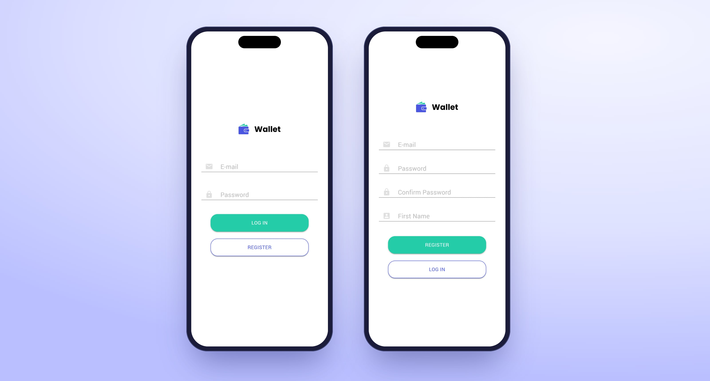

<p align="center">
  <picture>
    <source media="(prefers-color-scheme: dark)" srcset="docs/images/banner-dark.png">
    
  </picture>
</p>

<p align="center">
  
</p>

## About

<a href="https://damtchorzewski.github.io/S7venSurvivors-Wallet/"></a>

**Wallet Manager** is a cutting-edge application tailored for efficient personal finance management. With a user-centric
design and adaptability across diverse devices, it empowers users to effortlessly monitor transactions, track account
balances, analyze expenditures, and strategize budgets. It is a team project of the S7ven Survivors team.

- **Accounts.** Registration with e-mail confirmation (with a "resend" button) and login; the session is kept with
  `redux-persist`, and the private pages are guarded by `PrivateRoute` / `RestrictedRoute`.
- **Transactions.** A table of income and expenses with add, edit and delete windows (`ModalAddTransaction`,
  `ModalEditTransaction`) and the account balance next to it.
- **Statistics.** A doughnut chart (Chart.js) and a table of expenses by category for a chosen month and year.
- **Currency rates.** A USD and EUR purchase and sale table from the National Bank of Poland API.
- **Responsive.** A separate mobile dashboard (`DashboardMobile`) is chosen with `react-media`; a loader covers the
  waits for the API.
- **Deployed by Actions.** A push to `main` builds the app and publishes it to GitHub Pages.

> **Status:** a finished course project. The API is the Express and MongoDB backend in
> [`wallet`](https://github.com/DamTchorzewski/wallet), hosted on Render; its first answer after a pause can take a
> while. The "resend the confirmation e-mail" request in `RegistrationForm.jsx` still points at an older API host.

## Tech stack

|          |                                                                                                                  |
| -------- | ---------------------------------------------------------------------------------------------------------------- |
| Stack    | React 18, JavaScript (JSX), [Vite 4](https://vitejs.dev/), React Router 6                                        |
| UI       | MUI 5 with Emotion, CSS modules, `react-hook-form`, `notiflix`, `react-loader-spinner`, `react-media`            |
| Data     | Redux Toolkit, `redux-persist`, `axios`                                                                          |
| Charts   | Chart.js 4 with `react-chartjs-2`                                                                                |
| Services | Wallet API ([`wallet`](https://github.com/DamTchorzewski/wallet)), exchange rates of the National Bank of Poland |
| Tests    | none                                                                                                             |
| Hosting  | GitHub Pages, published by GitHub Actions (`.github/workflows/static.yml`)                                       |

The interface is in English; code and commits are in English.

## Screenshots

<p align="center">
  
</p>
<p align="center">
  
</p>

The dashboard and the statistics need an account on the API, so their images are the screenshots the team saved in
`src/utils/` (`dash.png`, `stat.png`); the login, registration and phone images are the live pages.

## Quick start

```bash
git clone https://github.com/DamTchorzewski/S7venSurvivors-Wallet.git
cd S7venSurvivors-Wallet
npm install
npm run dev      # http://localhost:5173/S7venSurvivors-Wallet/
```

Requirements: Node.js 18 LTS or newer and npm (the workflow builds with Node 18). The app is served under the
`/S7venSurvivors-Wallet` base path (`vite.config.js`).

## Scripts

| Command           | What it does                                                         |
| ----------------- | -------------------------------------------------------------------- |
| `npm run dev`     | development server with hot reload (`vite`)                          |
| `npm run build`   | production build to `dist/` (what the workflow runs)                 |
| `npm run preview` | serves the production build locally                                  |
| `npm run lint`    | ESLint over `src`, no warnings allowed                               |

## Configuration

None: no environment variables or keys. The API address is `axios.defaults.baseURL` in `src/redux/auth/actions.js`
and the exchange-rate address is in `src/components/Currency/Currency.jsx`; change them there.

## Structure

```
index.html                 the page; Vite entry
vite.config.js             base path /S7venSurvivors-Wallet
src/index.jsx              entry: store, persist gate, router
src/layouts/               ★ App.jsx (the routes), the layouts for guests and for signed-in users, Navigation
src/pages/                 login, registration, statistics and the home / diagram / currency tabs
src/components/            Dashboard (and mobile), transactions modals, Balance, Currency, chart, forms, Loader
src/redux/                 auth/ and trans/ (slices, actions, selectors), store.js
src/hook/                  useAuth, useTransactions
src/services/              date helpers
src/stylesheet/            fonts, variables and common styles
src/utils/                 logo, illustrations and the team's saved screenshots
docs/                      repository description; docs/images/ holds the README images (generated)
.github/workflows/         static.yml: build and publish to GitHub Pages from main
```

## Branches and workflows

Shared standards from `reops/standards`: `main` ≤ `develop` ≤ a working branch `<type>/<topic>`, Conventional
Commits in English. `static.yml` builds every push to `main` and publishes it to GitHub Pages. Details:
`reops/standards/git.md` and `reops/standards/workflows.md`.

**Departures from the standards (and why):**

- **A team project from a course:** the team worked on feature branches straight into `main`; there is no `develop`.
- **No CI beyond the deploy workflow, no tests and no `.env.example`:** the app has no configuration.
- **npm, not pnpm, and no `.nvmrc`:** the project predates the standards.
- **README images:** made by `tools/readme-images` (profile `S7venSurvivors-Wallet`); where a login is needed they are the team's own screenshots (see Screenshots).
- **No DamReboot footer:** a team project, not a company one.

## Documentation

| File                                | What it covers                                                |
| ----------------------------------- | ------------------------------------------------------------- |
| [docs/repository.md](docs/repository.md) | GitHub description and topics, and the command that sets them |

## Team

The S7ven Survivors team; the areas are from the git history.

| Who                                                           | Main work                                                       |
| ------------------------------------------------------------- | --------------------------------------------------------------- |
| [Damian Tchorzewski](https://github.com/DamTchorzewski)       | layouts and routing, statistics tab, buttons and modals, deploy |
| [piojank](https://github.com/piojank)                         | registration and login forms, authentication state (Redux)      |
| [Izabela Malinowska](https://github.com/IzabelaMalinowska)    | transactions table, loader, diagram tab and chart               |
| [Łukasz Kiwala](https://github.com/LukaszKiwala)              | currency table and navigation                                   |
| [Kacper Madajewski](https://github.com/KacperMadajewski)      | the "add transaction" button and window                         |
| [Domisiaxa](https://github.com/Domisiaxa)                     | logout window                                                   |

Licensed under the [MIT License](LICENSE).
